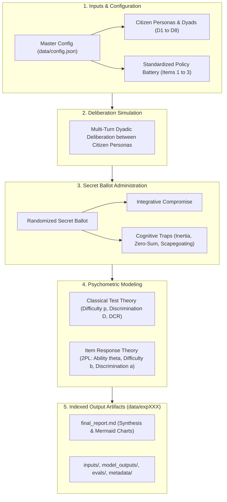

# Deliberative Simulation: Psychometric Benchmarking of Deliberative Capacity & Policy Dilemmas

[](https://www.python.org/downloads/)
[](LICENSE)
[](tests/)

An end-to-end psychometric evaluation framework for **LLM-driven Deliberative Democracy**. This repository applies **Classical Test Theory (CTT)** and **Item Response Theory (IRT)** to standardized multi-agent simulations across contentious public policy dilemmas in Singapore to empirically diagnose:

1. **Item Difficulty**: Which policy dilemmas are intrinsically harder or more prone to bad-faith traps?
2. **Latent Deliberative Ability**: Which citizen demographic groups struggle most with constructive deliberation?
3. **Item Discrimination**: Which policy items reliably differentiate high-competence dyads from vulnerable ones?
4. **Distractor Efficiency**: Which bad-faith cognitive heuristics (populist inertia, zero-sum technocracy, or foreign scapegoating) derail specific groups?

---

## 1. System Architecture

The simulation benchmark operates as an end-to-end sequential psychometric pipeline:



---

## 2. Standardized Test Battery & Distractor Taxonomy

The test battery consists of 3 standardized, contentious policy dilemmas grounded in Singapore public governance:

| Item ID   | Topic                              | Value Tension                                                                                 | Integrative Compromise Focus                                                                                                      |
| :-------- | :--------------------------------- | :-------------------------------------------------------------------------------------------- | :-------------------------------------------------------------------------------------------------------------------------------- |
| `ITEM_01` | **School Mergers & Closures**      | Heritage identity vs. demographic decline & resource pooling.                                 | Phased merger pooling specialized teachers/labs while preserving alumni archives and subsidized transit.                          |
| `ITEM_02` | **Foreign PMET Thresholds**        | Global hub competitiveness vs. local job displacement anxieties.                              | Points-based COMPASS evaluation weighting local wage percentiles, firm nationality diversity, and local PMET share.               |
| `ITEM_03` | **Transboundary Haze Enforcement** | Extraterritorial corporate accountability vs. diplomatic caution & jurisdictional boundaries. | Bilateral firefighting & satellite monitoring paired with mandatory domestic green finance / supply chain traceability standards. |

### Structured Distractor Taxonomy

Each item features 3 tempting deliberative traps representing classic cognitive failure modes:

- **Option B (Distractor 1 - Status Quo Inertia)**: Rigid refusal to adapt; demands deficit spending or freezes without addressing structural realities.
- **Option C (Distractor 2 - Technocratic Zero-Sum)**: Ruthless efficiency maximization completely ignoring citizen lived disruption and community identity.
- **Option D (Distractor 3 - External Scapegoating / Deflection)**: Diverting domestic accountability onto foreign or bureaucratic scapegoats.

> [!IMPORTANT]
> **Prompt Sterility & Separation of Concerns**:
> The taxonomy labels above (`Integrative Compromise`, `Status Quo Inertia`, `Technocratic Zero-Sum`, `External Scapegoating`) are analytical classifications for researchers and documentation. They are strictly segregated from the execution pipeline. The raw item JSON files in `data/items/` contain pristine policy proposals without parenthetical labels, ensuring LLM agents vote in an un-primed, observational setting. Furthermore, `src/ballot.py` incorporates defensive regex sanitization to guarantee runtime prompt sterility against accidental metadata leakage.

---

## 3. Deliberative Agent Personas

The benchmark models deliberative competence across four archetypal citizen personas crossing **Policy Knowledge** and **Affective Polarization**:

- **$P_1$: Technocratic Pragmatist** (`technocrat` | High Knowledge, Low Polarization): Calm, analytical, focused on feasibility, data, and institutional mechanisms.
- **$P_2$: Ideological Advocate** (`ideologue` | High Knowledge, High Polarization): Articulate, morally committed to preservation and equity; skeptical of technocratic coldness.
- **$P_3$: Disaffected Populist** (`populist` | Low Knowledge, High Polarization): Emotive, candid, feels sidelined by elites; defensive and prone to scapegoating heuristics.
- **$P_4$: Open-Minded Everyman** (`everyman` | Low Knowledge, Low Polarization): Plainspoken, humble, constructive; seeks common-sense harmony.

_(Note: Dyadic pairings between these personas, such as Technocrat vs. Ideologue or Ideologue vs. Populist, are defined dynamically in `data/config.json`. See [Modifying Experiment Parameters & Configuring data/config.json](#modifying-experiment-parameters--configuring-dataconfigjson) below for setup instructions)._

---

## 4. Psychometrics, Ranges & Mathematical Formulations

This framework evaluates deliberative performance across three complementary analytical dimensions:

1. **Classical Test Theory (CTT)** for direct item-level empirical statistics and distractor dynamics.
2. **Item Response Theory (IRT)** for model-based latent trait estimation and dilemma calibration.
3. **Individual Deliberative Behavioral Metrics** for persona-level compromise adoption rates.

---

### A. Classical Test Theory (CTT) Formulations

Classical Test Theory examines observed voting distributions and response properties directly from the experimental matrix.

#### 1. Item Difficulty / Consensus Rate ($p_i$)

The proportion of deliberative sessions where both participants in the dyad reach consensus by independently selecting the integrative compromise on their secret ballots:

$$
p_i = \frac{N_{\text{consensus}}}{N_{\text{sessions}}}
$$

- **Practical Range**: $[0.0, 1.0]$.
- **Diagnostic Interpretation**:
  - $p_i > 0.80$: Very easy dilemma with low intrinsic resistance to compromise.
  - $0.20 \le p_i \le 0.80$: Optimal diagnostic range providing maximal item variance across dyads.
  - $p_i < 0.20$: High-difficulty dilemma representing an acute polarization trap.
  - _(Note: In psychometrics, higher $p_i$ denotes an easier item)._

#### 2. Item Discrimination Index ($D_i$)

Measures an item's ability to differentiate between high-competence and low-competence dyads using Truman Kelley's optimal upper/lower 27% validation split:

$$
D_i = P_{i,\text{top}} - P_{i,\text{bottom}}
$$

where $P_{i,\text{top}}$ is the consensus rate of the top 27% deliberative sessions (ranked by total performance across all battery items) and $P_{i,\text{bottom}}$ is the consensus rate of the bottom 27%.

- **Practical Range**: $[-1.0, +1.0]$.
- **Diagnostic Interpretation**:
  - $D \ge 0.40$: Excellent discrimination (cleanly separates skilled from vulnerable dyads).
  - $0.30 \le D \le 0.39$: Good discrimination.
  - $0.20 \le D \le 0.29$: Acceptable discrimination.
  - $0.0 \le D < 0.20$: Poor discrimination (dilemma yields similar outcomes regardless of dyadic capability).
  - $D < 0.0$: Defective item (vulnerable groups find compromise more readily than skilled groups).

#### 3. Distractor-to-Correct Ratio ($\text{DCR}_k$)

Quantifies the relative cognitive pull of bad-faith heuristic $k$ against the integrative compromise across all individual secret ballots cast:

$$
\text{DCR}_k = \frac{\text{Count of selections for Distractor } k}{\text{Count of selections for Integrative Compromise}}
$$

Diagnoses whether non-compromise outcomes were driven by **Status Quo Inertia** (Distractor B), **Technocratic Coldness** (Distractor C), or **External Scapegoating** (Distractor D).

- **Practical Range**: $[0.0, +\infty)$.
- **Diagnostic Interpretation**:
  - $\text{DCR} = 0.0$: Completely unselected / non-functioning distractor.
  - $0.0 < \text{DCR} < 1.0$: Subdominant trap (the integrative compromise was chosen more often than this heuristic).
  - $\text{DCR} = 1.0$: Parity trap (heuristic chosen with equal frequency to the integrative compromise).
  - $\text{DCR} > 1.0$: Dominant trap (bad-faith heuristic successfully out-competes the integrative compromise).
- **Vote Share Conversion**: DCR is a relative ratio against the integrative compromise, not a raw percentage. To convert DCR into the empirical percentage distribution of votes:

$$
\text{Compromise Vote Share} = \frac{1}{1 + \text{DCR}_B + \text{DCR}_C + \text{DCR}_D} \times 100
$$

$$
\text{Distractor } k \text{ Vote Share} = \frac{\text{DCR}_k}{1 + \text{DCR}_B + \text{DCR}_C + \text{DCR}_D} \times 100
$$

#### Sample Size Pooling & Execution Matrix Dynamics

$$
\text{Sessions per Dilemma} = \text{trials} \times N_{\text{dyads}} \quad (\text{e.g., } 3 \times 8 = 24\text{ sessions})
$$

$$
\text{Individual Secret Ballots per Dilemma} = \text{Sessions} \times 2\text{ agents} \quad (\text{e.g., } 24 \times 2 = 48\text{ votes})
$$

$$
\text{Total Benchmark Matrix} = \text{Sessions per Dilemma} \times N_{\text{items}} \quad (\text{e.g., } 24 \times 3 = 72\text{ sessions, } 144\text{ votes})
$$

- **Consensus Rate ($p_i$)** is computed at the **session level** ($N = 24$ per dilemma); an item passes only when both agents independently vote for the integrative compromise.
- **Distractor Ratios ($\text{DCR}_k$)** are computed at the **individual secret ballot level** ($N = 48$ per dilemma).
- **Persona Representation**: Across the 8 dyads, each citizen persona participates in 4 dyadic pairings (twice as speaker 1 and twice as speaker 2), yielding 36 individual ballots per persona ($4 \text{ pairings} \times 3 \text{ trials} \times 3 \text{ items} = 36$).

---

### B. Item Response Theory (IRT) Formulations

Using a **2-Parameter Logistic (2PL) Model** fitted via regularized Maximum Likelihood Estimation (L-BFGS-B with Gaussian priors on $\theta$, $b$, and $a$):

$$
P(Y_{ji} = 1 \mid \theta_j, a_i, b_i) = \frac{1}{1 + e^{-a_i (\theta_j - b_i)}}
$$

where $Y_{ji} \in \\{0, 1\\}$ is the binary outcome of deliberator $j$ on dilemma $i$.

#### 1. IRT Item Difficulty ($b_i$)

The latent deliberative ability threshold required for a deliberative agent to have a 50% probability of adopting the integrative compromise ($P(Y=1) = 0.50$).

- **Practical Range**: $[-4.0, +4.0]$ (under Gaussian prior $N(0, 1)$).
- **Diagnostic Interpretation**:
  - $b < -1.0$: Low intrinsic difficulty (readily resolved by most deliberators).
  - $-1.0 \le b \le +1.0$: Moderate difficulty dilemma.
  - $b > +1.0$: High intrinsic difficulty (requires advanced deliberative competence to overcome polarization).

#### 2. IRT Item Discrimination ($a_i$)

The slope of the Item Characteristic Curve (ICC) at $\theta = b_i$, reflecting how sharply the dilemma differentiates between differing ability levels.

- **Practical Range**: $[0.1, 4.0]$.
- **Diagnostic Interpretation**:
  - $a < 0.65$: Low discrimination (weak diagnostic power).
  - $0.65 \le a \le 1.34$: Moderate discrimination.
  - $1.35 \le a \le 1.69$: High discrimination.
  - $a \ge 1.70$: Very high discrimination (cleanly separates ability tiers).

#### 3. Latent Deliberative Ability ($\theta$)

The standardized competence trait of a deliberator, estimated under regularized maximum likelihood.

- **Practical Range**: $[-4.0, +4.0]$ ($N(0, 1)$ standardized).
- **Diagnostic Interpretation**:
  - $\theta > +1.0$: High deliberative ability (regularly identifies and votes for integrative solutions).
  - $-0.5 \le \theta \le +0.5$: Average deliberative capacity.
  - $\theta < -1.0$: Low deliberative ability (highly vulnerable to bad-faith heuristics and impasse).
- **Deliberator Scopes**:
  - **Dyadic Deliberative Competence (`dyad_theta`)**: Joint consensus convergence where both agents in the dyad simultaneously vote for the integrative compromise.
  - **Individual Persona Competence (`individual_theta`)**: Persona's marginal baseline propensity to vote for the integrative compromise across all dilemmas.
  - **Partner Interaction Effects (`persona_by_dyad_theta`)**: Persona's latent ability conditioned on the specific dyadic partner, isolating communicative synergy and polarization shifts.

---

### C. Individual Deliberative Behavioral Metrics

#### 1. Individual Success Rate

The empirical proportion of secret ballots where persona $p$ voted for the integrative compromise across all dilemmas and dyad configurations they deliberated in:

$$
\text{Individual Success Rate}_p = \frac{\sum \mathbf{1}(\text{Vote}_p = \text{Integrative Compromise})}{N_{\text{trials}}(p)}
$$

- **Practical Range**: $[0.0, 1.0]$ (0% to 100%).
- **Distinction from CTT Consensus Rate ($p_i$)**:
  - $p_i$ is an **item-level consensus metric** requiring _both_ members of a dyad to select the integrative compromise simultaneously.
  - Individual Success Rate is a **persona-level behavioral metric** measuring an individual agent's unconstrained willingness to adopt integrative solutions regardless of whether their partner agreed.
- **Diagnostic Utility**: Isolates whether failure to reach consensus was symmetric (both agents chose cognitive traps) or asymmetric (one agent voted for the compromise while the other defected).

---

## 5. Repository Structure

```text
simple-simulation-irt-evaluation-in-deliberation/
├── data/
│   ├── config.json                     # Master simulation configuration
│   ├── items/                          # Standardized test battery
│   │   ├── item01_school_mergers_description.json
│   │   ├── item02_foreign_talent_description.json
│   │   └── item03_transboundary_haze_description.json
│   └── exp000/                         # Auto-incrementing experiment run output
│       ├── inputs/                     # Run configuration snapshot & battery items
│       │   ├── config.json
│       │   └── items/
│       │       ├── item01_school_mergers_description.json
│       │       ├── item02_foreign_talent_description.json
│       │       └── item03_transboundary_haze_description.json
│       ├── model_outputs/              # Deliberation transcripts & secret ballots
│       │   ├── ballots.json
│       │   └── transcripts/            # Item transcripts (.json + reviewable .pdf)
│       │       ├── item01_school_mergers_transcript.json
│       │       ├── item01_school_mergers_transcript.pdf
│       │       ├── item02_foreign_talent_transcript.json
│       │       ├── item02_foreign_talent_transcript.pdf
│       │       ├── item03_transboundary_haze_transcript.json
│       │       └── item03_transboundary_haze_transcript.pdf
│       ├── evals/                      # Evaluative outputs & markdown synthesis
│       │   ├── final_report.md
│       │   └── psychometric_evals.json
│       └── metadata/                   # Execution telemetry, token usage & runtime
│           └── metadata.json
├── docs/
│   ├── coding_guidelines.md
│   ├── experiment_design_psychometric_eval_deliberation.md
│   └── reviewer_feedback_response.md
├── src/
│   ├── __init__.py
│   ├── main.py                         # Master orchestrator (execute_simulation_run) & CLI entry point
│   ├── baselines.py                    # Counterfactual zero-shot pre-deliberation baseline suite
│   ├── deliberation.py                 # Multi-turn dyadic deliberation chat loop
│   ├── ballot.py                       # Secret ballot runner with option display randomization & strict parsing
│   ├── psychometrics.py                # CTT & IRT (1PL/2PL) regularized optimization engine
│   ├── personas.py                     # Persona metadata & configuration prompt resolution
│   ├── transcripts_pdf.py              # Deliberation transcript PDF generator (ReportLab)
│   ├── llm.py                          # OpenAI client with .env credentials and reasoning configuration
│   ├── schemas.py                      # Built-in typing schemas (TypedDict)
│   └── report.py                       # Synthesis and Markdown report compiler
├── tests/
│   ├── __init__.py
│   ├── test_ballot_parser.py           # Validates option extraction and randomization
│   ├── test_deliberation.py            # Validates dialogue turn structure
│   ├── test_model_availability.py      # Validates model endpoint reachability
│   ├── test_pipeline.py                # End-to-end integration test
│   ├── test_psychometrics.py           # Validates CTT & IRT monotonicity & bounds
│   └── test_transcripts_pdf.py         # Validates transcript PDF generation
├── .env.example
├── pyproject.toml
├── requirements.txt
└── README.md
```

---

## 6. Quickstart & Installation

### Installation

Clone the repository and install dependencies:

```bash
git clone https://github.com/your-username/deliberative-irt-simulation.git
cd deliberative-irt-simulation
pip install -r requirements.txt
```

### Environment Configuration (.env)

Configure your OpenAI-compatible endpoint credentials (e.g., Together AI, vLLM, OpenRouter) in `.env`. Both `OPENAI_API_KEY` and `OPENAI_BASE_URL` are required; there are no dummy fallback credentials, and runs will fail immediately if they are missing. Models are configured strictly in `data/config.json` rather than `.env`.

```env
OPENAI_API_KEY=your-api-key-here
OPENAI_BASE_URL=https://api.together.xyz/v1
```

### Running Unit & Integration Tests

```bash
python3 -m pytest tests -v
```

### Running a Simulation Experiment

All experimental parameters (models, turns, trials, dyads, items, and `mcq_option_order_seed`) are configured centrally in `data/config.json`. The CLI accepts **only** the path to the configuration file.

Run with default configuration (`data/config.json`):

```bash
python3 -m src.main
```

Or specify a custom configuration file:

```bash
python3 -m src.main --config path/to/custom_config.json
```

Artifacts are dynamically written to the next auto-incremented `data/expXXX/` directory:

- `data/expXXX/evals/final_report.md`: Complete Markdown synthesis with Mermaid diagrams and psychometric tables
- `data/expXXX/evals/psychometric_evals.json`: Fitted $\theta$, $b$, $a$, DCRs, and governance rankings
- `data/expXXX/model_outputs/transcripts/`: Item-by-item dialogue transcripts (JSON and reviewable PDF)
- `data/expXXX/model_outputs/ballots.json`: Independent secret ballot selections and validity status
- `data/expXXX/inputs/config.json`: Snapshot of the configuration used for the experiment run
- `data/expXXX/inputs/items/`: Snapshot of all policy battery item definitions used for the run
- `data/expXXX/metadata/metadata.json`: Runtime telemetry, total prompt/completion tokens, and API compute cost

#### Modifying Experiment Parameters & Configuring `data/config.json`

All experimental parameters (models, turns, trials, dyads, items, prompts, and seeds) are managed centrally in `data/config.json`. Below is an example master configuration structure and instructions on how to manipulate both self-explanatory and nontrivial fields:

```json
{
  "experiment_metadata": {
    "name": "Psychometric Deliberative Capacity Benchmark",
    "description": "Observing latent deliberative competence and item psychometrics across diverse citizen groups and Singapore policy dilemmas",
    "version": "3"
  },
  "model_config": {
    "agent_model": "Qwen/Qwen3.5-9B",
    "enable_reasoning": false,
    "reasoning_effort": "low",
    "temperature": 0.7,
    "deliberation_max_tokens": 1024,
    "ballot_max_tokens": 1024,
    "seed": null
  },
  "system_prompts": { ... },
  "user_prompts": { ... },
  "items": [
    "data/items/item01_school_mergers_description.json",
    "data/items/item02_foreign_talent_description.json",
    "data/items/item03_transboundary_haze_description.json"
  ],
  "deliberation_config": {
    "turns_per_item": 4,
    "trials_per_item": 3,
    "mcq_option_order_seed": 42,
    "dyads": [
      {
        "id": "D1",
        "name": "Technocrat vs Ideologue",
        "dynamic": "Ideological Friction",
        "agents": ["technocrat", "ideologue"]
      },
      {
        "id": "D2",
        "name": "Technocrat vs Populist",
        "dynamic": "Asymmetric Vulnerability",
        "agents": ["technocrat", "populist"]
      },
      {
        "id": "D3",
        "name": "Ideologue vs Populist",
        "dynamic": "Polarized Stalemate",
        "agents": ["ideologue", "populist"]
      },
      {
        "id": "D4",
        "name": "Ideologue vs Everyman",
        "dynamic": "Rhetorical Dominance",
        "agents": ["ideologue", "everyman"]
      },
      {
        "id": "D5",
        "name": "Populist vs Everyman",
        "dynamic": "Grassroots Realignment",
        "agents": ["populist", "everyman"]
      },
      {
        "id": "D6",
        "name": "Populist vs Technocrat",
        "dynamic": "Anti-Elitist Pushback",
        "agents": ["populist", "technocrat"]
      },
      {
        "id": "D7",
        "name": "Everyman vs Technocrat",
        "dynamic": "Pragmatic Grounding",
        "agents": ["everyman", "technocrat"]
      },
      {
        "id": "D8",
        "name": "Everyman vs Ideologue",
        "dynamic": "Moral Grounding",
        "agents": ["everyman", "ideologue"]
      }
    ]
  }
}
```

##### 1. Setting Up Dyad Configurations (`deliberation_config.dyads`)

The `dyads` list specifies which citizen personas engage in deliberative dialogue against each other. Each entry defines a structured interpersonal test condition:

| Field         |    Type     | Description & Purpose                                                                                                                                                                                                                                                                                                                                                                 |
| :------------ | :---------: | :------------------------------------------------------------------------------------------------------------------------------------------------------------------------------------------------------------------------------------------------------------------------------------------------------------------------------------------------------------------------------------ |
| **`id`**      |  `string`   | **Unique Dyad Identifier** (e.g., `"D1"`, `"D2"`, `"D_CUSTOM"`). Tags transcripts, ballot records, and aggregate dyadic psychometric scores ($\theta_{\text{dyad}}$).                                                                                                                                                                                                                 |
| **`name`**    |  `string`   | **Human-Readable Label** (e.g., `"Technocrat vs Ideologue"`). Displayed in console logs, progress bars, and the Markdown synthesis report.                                                                                                                                                                                                                                            |
| **`dynamic`** |  `string`   | **Qualitative Sociopolitical Description** (e.g., `"Ideological Friction"`, `"Asymmetric Vulnerability"`, `"Polarized Stalemate"`). Classifies the theoretical tension for reporting and downstream analysis.                                                                                                                                                                         |
| **`agents`**  | `list[str]` | **Exact 2-Element Array of Persona Keys** matching the keys defined in `system_prompts` (e.g., `["technocrat", "ideologue"]`).<br>• **Turn Sequence**: The order in `agents` dictates conversational turn taking (`agents[0]` speaks on turns 0 and 2; `agents[1]` speaks on turns 1 and 3).<br>• **Validation**: Every key in `agents` must match an active key in `system_prompts`. |

**Example: Adding or Customizing a Dyad**:
To test how an Open-Minded Everyman interacts with a Technocrat, append a new object to the `dyads` array:

```json
{
  "id": "D4",
  "name": "Technocrat vs Everyman",
  "dynamic": "Institutional Translation",
  "agents": ["technocrat", "everyman"]
}
```

---

##### 2. Nontrivial Configuration Fields

- **`user_prompts` (Prompt Templates & Dynamic Placeholders)**:
  Contains template strings formatted dynamically during execution using Python's `{field}` substitution.
  - **`deliberation_turn`**: Formats the conversational prompt sent to the active agent on each dialogue turn. Requires `{title}`, `{topic_prompt}`, and `{conversation_history}` (which automatically compiles all prior turns into a transcript block).
  - **`secret_ballot`**: Formats the post-deliberation voting prompt. Requires `{title}`, `{topic_prompt}`, `{transcript_summary}`, and `{formatted_options}`.
    > [!IMPORTANT]
    > The `secret_ballot` template instructs the model to return **only** a single letter (A, B, C, or D). The defensive regex parser in `src/ballot.py` inspects this response to extract the choice against the randomized presentation order.

- **`system_prompts` (Persona Specifications)**:
  A key-value dictionary where keys are persona identifiers (`technocrat`, `ideologue`, `populist`, `everyman`) and values are multi-line system prompts defining their role, policy knowledge level, affective polarization, behavioral heuristics, and conversational tone. To add a custom persona (e.g., `"environmentalist"`), add its system prompt here and reference it in a dyad's `agents` array.

- **`items` (Policy Test Battery Paths)**:
  An array of relative file paths to item JSON definitions (e.g. `"data/items/item01_school_mergers_description.json"`). To evaluate a subset of items or introduce new policy dilemmas, add or remove paths from this list. Each item JSON must define `item_id`, `title`, `topic_prompt`, and `ballot` (containing `options` A-D, and `correct_key`).

- **`mcq_option_order_seed` (Option Randomization Seed)**:
  Base integer seed (`42`) used to dynamically shuffle multiple-choice options (A, B, C, D) on each secret ballot. Rather than fixing a static option order per item, option positions are dynamically re-randomized for each individual agent ballot using an independent pseudo-random generator initialized with:

  ```python
  agent_seed = (mcq_option_order_seed + session_step * 17) + agent_idx * 1000 + trial_index
  ```

  where `session_step` tracks the global deliberation sequence ($1$ to $72$), `agent_idx` indexes the citizen within the dyad ($0$ or $1$), and `trial_index` indexes the replication trial ($0$ to $2$). This dynamic per-ballot re-drawing ensures that neither partner in a dyad nor consecutive trials receive identical letter mappings, decoupling option letter positions from underlying semantic keys and neutralizing LLM positional bias. (Legacy config files using `"seed"` are supported via automatic fallback).

---

##### 3. Self-Explanatory Parameters (One-Liners)

- **`experiment_metadata.name`**: Human-readable benchmark name recorded in output snapshots.
- **`experiment_metadata.description`**: Brief high-level summary of the experiment's research scope.
- **`experiment_metadata.version`**: Benchmark schema version string (e.g., `"3"`).
- **`model_config.agent_model`**: LLM endpoint model identifier (e.g., `"Qwen/Qwen3.5-9B"`).
- **`model_config.enable_reasoning`**: Optional boolean to explicitly enable or disable internal reasoning tokens (configured to `false` for Qwen to enforce direct dialogue and single-letter ballot formatting).
- **`model_config.reasoning_effort`**: Optional reasoning budget level on supporting endpoints (`"low"`, `"medium"`, `"high"`; set to `"low"` for DeepSeek, GPT-OSS, and Muse-Spark).
- **`model_config.temperature`**: Sampling temperature for multi-turn dialogue (default `0.7`).
- **`model_config.deliberation_max_tokens`**: Maximum token limit allocated per dialogue turn (default `1024`).
- **`model_config.ballot_max_tokens`**: Maximum token limit allocated for secret ballot voting (default `1024`).
- **`model_config.seed`**: Optional integer seed for LLM text generation reproducibility (default `null` / `None` for stochastic generation).
- **`deliberation_config.turns_per_item`**: Number of alternating dialogue turns per session (default `4`, giving 2 turns per agent).
- **`deliberation_config.trials_per_item`**: Number of independent simulation trials per item-dyad combination (default `3` trials $\times$ 8 dyads = 24 sessions per dilemma; yielding $3 \times 8 \times 3 = 72$ total benchmark sessions, 144 ballots).

### Running Counterfactual Pre-Deliberation Baselines

To measure baseline option preferences zero-shot without communicative exposure:

```bash
python3 -m src.baselines --model "openai/gpt-oss-120b" --trials 5
```

---

## 7. Built-in Code Defaults & Fallback Reference

All default parameters, fallback chains, and optimization bounds hardcoded within Python logic are documented below:

| Module / Scope                                  | Parameter                    | Code Default / Fallback                          | Behavior & Purpose                                                                                                                                                                                                      |
| :---------------------------------------------- | :--------------------------- | :----------------------------------------------- | :---------------------------------------------------------------------------------------------------------------------------------------------------------------------------------------------------------------------- |
| **Model Resolution** (`src/llm.py`)             | `agent_model`                | **No fallback**                                  | Strictly read from `model_config.agent_model` in `config.json`. Fails fast with `ValueError` if omitted. Model configuration is never extracted from `.env`.                                                            |
| **Reasoning Control** (`src/llm.py`)            | `enable_reasoning`           | `True`                                           | Configured per model in `model_config`. When `False`, reasoning tokens are disabled to guarantee unmediated dialogue and prompt adherence.                                                                              |
| **Reasoning Effort** (`src/llm.py`)             | `reasoning_effort`           | `"low"`                                          | Passed to supporting reasoning model endpoints (e.g., DeepSeek, GPT-OSS, Muse-Spark) to constrain internal deliberation tokens.                                                                                         |
| **Model Inference Seed** (`src/llm.py`)         | `seed`                       | `None` (`null`)                                  | Controls deterministic LLM inference on endpoints supporting seed parameter. Defaults to `None` for unconstrained stochastic diversity.                                                                                 |
| **API Credentials** (`src/llm.py`)              | `api_key`, `base_url`        | **No fallback**                                  | Strictly read from `OPENAI_API_KEY` and `OPENAI_BASE_URL` in `.env`. Fails fast with `ValueError` if either is missing.                                                                                                 |
| **Dialogue Turns** (`src/deliberation.py`)      | `temperature` / `max_tokens` | `0.7` / `1024`                                   | Balanced exploratory sampling for multi-turn citizen dialogue. Resolved via `deliberation_max_tokens` -> `max_tokens` -> `1024`.                                                                                        |
| **Secret Ballot** (`src/ballot.py`)             | `temperature` / `max_tokens` | `0.3` / `1024`                                   | Low temperature ensures deterministic option voting. Allocated 1024 tokens to ensure reasoning models do not exhaust generation tokens before emitting a choice.                                                        |
| **Ballot Validation** (`src/ballot.py`)         | Parsed Choice                | **Strict Two-Tier Match**                        | Extracts exact isolated letters (`A`, `B`, `C`, `D`) or anchored prefixes (`Choice: A`, `Option: B`, `Answer: C`). Unanchored choices return `None`, mark `is_valid: False`, and are discarded. |
| **Run Failure Guardrail** (`src/main.py`)       | Abort Validation             | **Aborts report**                                | If all deliberation statements or all ballots across the run are empty, prints a prominent critical error in terminal and aborts report generation (`final_report.md` and `psychometric_evals.json` are skipped).       |
| **Simulation Matrix** (`src/main.py`)           | `turns_per_item`             | `4`                                              | 4 alternating dialogue turns per session (2 turns per persona).                                                                                                                                                         |
| **Simulation Matrix** (`src/main.py`)           | `trials_per_item`            | `3`                                              | 3 independent trials per item-dyad combination (72 total sessions across benchmark, 144 ballots).                                                                                                                       |
| **Option Shuffling Seed** (`src/main.py`)       | `mcq_option_order_seed`      | `42` (legacy fallback: `seed`)                   | Base pseudo-random seed for dynamically shuffling option presentation order (A/B/C/D) via `agent_seed = (seed + step * 17) + idx * 1000 + trial`.                                                                      |
| **Output Directory** (`src/main.py`)            | `output_dir`                 | `data/expXXX/`                                   | Auto-detects highest existing `expXXX` and increments to the next index (starts at `exp000`).                                                                                                                           |
| **IRT Regularization** (`src/psychometrics.py`) | L2 Priors ($\lambda$)        | `0.5` ($\theta, b$), `0.5` ($a - 1$)             | Regularizes maximum likelihood estimation against overfitting on small samples.                                                                                                                                         |
| **IRT Optimization** (`src/psychometrics.py`)   | Parameter Bounds             | $\theta, b \in [-4.0, +4.0]$, $a \in [0.1, 4.0]$ | Bounded L-BFGS-B optimization (`maxiter=500, ftol=1e-6`).                                                                                                                                                               |
| **CTT Group Split** (`src/psychometrics.py`)    | Upper/Lower Ratio            | 27%                                              | Truman Kelley's optimal top/bottom 27% split (`math.ceil(0.27 * N)`).                                                                                                                                                   |

---

## 8. License

This repository is distributed under the MIT License. See [LICENSE](LICENSE) for details.
