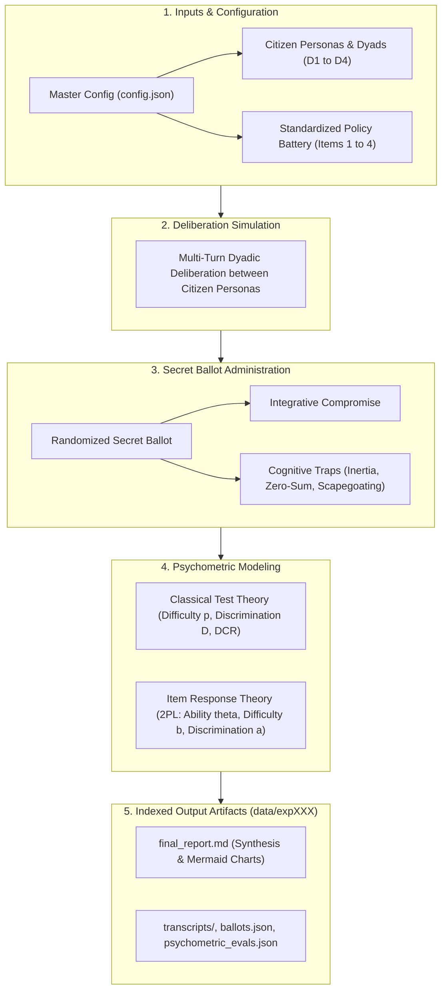

# Deliberative Item Response Theory (IRT) Benchmark Report

**Generated:** 2026-10-30 21:13:05  
**Benchmark:** Psychometric Deliberative Capacity Benchmark  
**Model:** `deepseek-ai/DeepSeek-V4.1-Flash-1017`  
**Execution Matrix:** 3 trials/dyad across 8 dyads and 3 items (72 total sessions, 144 secret ballots)  
**Per-Item Sample:** 24 deliberative sessions (48 individual secret ballots cast)  
**Runtime:** 11m 39.0s (699.0s)  
**Estimated Cost:** $0.1118 USD  

---

## 1. Executive Summary & Core Insights

This psychometric benchmark evaluates **latent deliberative capacity ($\theta$)** across diverse citizen demographic dyads and measures **item difficulty ($b$)**, **item discrimination ($a$)**, and **distractor efficiency (DCR)** across standardized Singapore public policy dilemmas.

### Key Empirical Findings:
- **Most Challenging Policy Dilemma**: Policy item `ITEM_01` exhibited the highest intrinsic difficulty parameter ($b$).
- **Most Accessible Compromise**: Policy item `ITEM_01` had the lowest difficulty parameter, proving most receptive to common ground.
- **Most Diagnostic Dilemma**: Policy item `ITEM_01` showed the highest discrimination parameter ($a$), reliably distinguishing high-deliberation dyads from vulnerable ones.
- **Most Vulnerable Citizen Dyad**: Dyad `D1` demonstrated the lowest baseline latent deliberative competence ($\theta$).
- **Most Tempting Distractor Trap**: Option `B` was the most frequently chosen bad-faith heuristic across participants.

---

## 2. Deliberation & Psychometric Architecture

---

## 3. Standardized Policy Battery Psychometrics

### 3.1 Classical Test Theory (CTT) Empirical Metrics
Direct observational statistics measuring empirical consensus difficulty ($p_i$), Kelley's upper-lower discrimination index ($D_i$), and cognitive distractor ratios ($\text{DCR}$):

| Item ID | Policy Dilemma Topic | Consensus Rate ($p_i$) | Discrimination ($D_i$) | DCR (B: Inertia) | DCR (C: Zero-Sum) | DCR (D: Scapegoat) |
| :--- | :--- | :---: | :---: | :---: | :---: | :---: |
| `ITEM_01` | School Closures and Mergers in Sin... | 1.0 | 0.0 | 0.0 | 0.0 | 0.0 |
| `ITEM_02` | Foreign PMET Salary Thresholds and... | 1.0 | 0.0 | 0.0 | 0.0 | 0.0 |
| `ITEM_03` | Transboundary Haze Enforcement and... | 1.0 | 0.0 | 0.0 | 0.0 | 0.0 |

> [!NOTE]
> **CTT Metric Interpretation Guide**:
> - **Consensus Rate ($p_i$)**: The proportion of deliberative sessions where *both* participants in the dyad simultaneously voted for the integrative compromise across all **24 sessions** ($5\text{ trials} \times 8\text{ dyads}$).  
> - **Item Discrimination ($D_i$)**: Kelley's optimal upper/lower 27% validation split ($P_{\text{top}} - P_{\text{bottom}}$), measuring separation between top- and bottom-performing dyads.  
> - **DCR (Distractor-to-Correct Ratio)**: A relative ratio against the integrative compromise, **not a percentage of total votes**: $\text{DCR}_k = \frac{\text{Count}(\text{Distractor } k)}{\text{Count}(\text{Integrative Compromise})}$. Evaluated across all **48 individual secret ballots** cast for that dilemma.  
>   - $\text{DCR} > 1.0$: Dominant trap (bad-faith heuristic was chosen *more frequently* than the compromise).  
>   - $\text{DCR} < 1.0$: Subdominant trap (the integrative compromise was chosen more frequently than this heuristic).  
>   - $\text{DCR} = 1.0$: Parity trap (equal frequency to compromise).  
>   - *Note on vote percentages*: DCR values do not sum to 100%. The actual percentage of votes for the integrative compromise is $\frac{1}{1 + \text{DCR}_B + \text{DCR}_C + \text{DCR}_D} \times 100\%$.  

### 3.2 Item Response Theory (2PL IRT) Calibrated Parameters
Latent difficulty threshold ($b_i$) and discrimination slope ($a_i$) calibrated via regularized Maximum Likelihood Estimation:

| Item ID | Policy Dilemma Topic | Difficulty ($b_i$) | Discrimination ($a_i$) | Diagnostic Characteristic |
| :--- | :--- | :---: | :---: | :--- |
| `ITEM_01` | School Closures and Mergers in Sin... | -1.6264 | 2.2961 | Low Difficulty, Very High Discrimination |
| `ITEM_02` | Foreign PMET Salary Thresholds and... | -1.6264 | 2.2961 | Low Difficulty, Very High Discrimination |
| `ITEM_03` | Transboundary Haze Enforcement and... | -1.6264 | 2.2961 | Low Difficulty, Very High Discrimination |

> [!NOTE]
> **IRT Metric Interpretation Guide**:
> - **Item Difficulty ($b_i$)**: The latent ability threshold $\theta$ required for a 50% probability of consensus on the integrative compromise. Higher $b_i$ indicates greater intrinsic resistance to resolution.
> - **Item Discrimination ($a_i$)**: The slope of the Item Characteristic Curve (ICC) at $\theta = b_i$. Values $a \ge 1.70$ represent very high diagnostic separation between high- and low-competence dyads.

---

## 4. Latent Deliberative Ability Breakdown ($\theta$)

### 4.1 Dyadic Deliberative Competence (Consensus Requirement)
Estimated collective latent competence $\theta$ across citizen dyad configurations (an item is passed only when both participants reach consensus on the integrative compromise):

| Dyad ID | Citizen Composition | Deliberative Dynamic | Collective Competence ($\theta$) | Relative Ranking |
| :--- | :--- | :--- | :---: | :---: |
| `D1` | Technocrat vs Ideologue | Ideological Friction | 0.2033 | #1 |
| `D2` | Technocrat vs Populist | Asymmetric Vulnerability | 0.2033 | #2 |
| `D3` | Ideologue vs Populist | Polarized Stalemate | 0.2033 | #3 |
| `D4` | Ideologue vs Everyman | Rhetorical Dominance | 0.2033 | #4 |
| `D5` | Populist vs Everyman | Grassroots Realignment | 0.2033 | #5 |
| `D6` | Populist vs Technocrat | Anti-Elitist Pushback | 0.2033 | #6 |
| `D7` | Everyman vs Technocrat | Pragmatic Grounding | 0.2033 | #7 |
| `D8` | Everyman vs Ideologue | Moral Grounding | 0.2033 | #8 |

### 4.2 Individual Persona Deliberative Competence & Success Rates
Performance metrics for each citizen persona across independent secret ballots:
- **Individual Success Rate**: Empirical proportion of secret ballots where the persona voted for the integrative compromise.
- **Latent Competence ($\theta$)**: Standardized 2PL IRT ability score isolating individual deliberative capacity.

| Persona ID | Role Title | Individual Success Rate | Latent Competence ($\theta$) | Relative Ranking |
| :--- | :--- | :---: | :---: | :---: |
| `everyman` | Open-Minded Everyman (P4) | 100.0% | 0.1155 | #1 |
| `ideologue` | Ideological Advocate (P2) | 100.0% | 0.1155 | #2 |
| `populist` | Disaffected Populist (P3) | 100.0% | 0.1155 | #3 |
| `technocrat` | Technocratic Pragmatist (P1) | 100.0% | 0.1155 | #4 |

### 4.3 Partner Interaction Effects (Dyadic Conditioning)
How each individual persona's latent competence shifts depending on conversational partner in the dyad:

| Persona | Partner Dynamic in Dyad | Latent Competence ($\theta$) | Observed Shift / Context |
| :--- | :--- | :---: | :--- |
| Open-Minded Everyman (P4) | `D4` (Rhetorical Dominance) | 0.1155 | Paired in Ideologue vs Everyman |
| Open-Minded Everyman (P4) | `D5` (Grassroots Realignment) | 0.1155 | Paired in Populist vs Everyman |
| Open-Minded Everyman (P4) | `D7` (Pragmatic Grounding) | 0.1155 | Paired in Everyman vs Technocrat |
| Open-Minded Everyman (P4) | `D8` (Moral Grounding) | 0.1155 | Paired in Everyman vs Ideologue |
| Ideological Advocate (P2) | `D1` (Ideological Friction) | 0.1155 | Paired in Technocrat vs Ideologue |
| Ideological Advocate (P2) | `D3` (Polarized Stalemate) | 0.1155 | Paired in Ideologue vs Populist |
| Ideological Advocate (P2) | `D4` (Rhetorical Dominance) | 0.1155 | Paired in Ideologue vs Everyman |
| Ideological Advocate (P2) | `D8` (Moral Grounding) | 0.1155 | Paired in Everyman vs Ideologue |
| Disaffected Populist (P3) | `D2` (Asymmetric Vulnerability) | 0.1155 | Paired in Technocrat vs Populist |
| Disaffected Populist (P3) | `D3` (Polarized Stalemate) | 0.1155 | Paired in Ideologue vs Populist |
| Disaffected Populist (P3) | `D5` (Grassroots Realignment) | 0.1155 | Paired in Populist vs Everyman |
| Disaffected Populist (P3) | `D6` (Anti-Elitist Pushback) | 0.1155 | Paired in Populist vs Technocrat |
| Technocratic Pragmatist (P1) | `D1` (Ideological Friction) | 0.1155 | Paired in Technocrat vs Ideologue |
| Technocratic Pragmatist (P1) | `D2` (Asymmetric Vulnerability) | 0.1155 | Paired in Technocrat vs Populist |
| Technocratic Pragmatist (P1) | `D6` (Anti-Elitist Pushback) | 0.1155 | Paired in Populist vs Technocrat |
| Technocratic Pragmatist (P1) | `D7` (Pragmatic Grounding) | 0.1155 | Paired in Everyman vs Technocrat |

---

## 5. Cognitive Trap & Distractor Vulnerability Analysis

The standardized assessment tests three distinct heuristic failure modes:
1. **Option B (Status Quo Inertia Trap)**: Rigid refusal to adapt; demanding infinite subsidies without addressing structural change.
2. **Option C (Technocratic Zero-Sum Trap)**: Aggressive efficiency-only policy that completely disregards human/community disruption.
3. **Option D (External Scapegoating / Deflection Trap)**: Deflecting structural challenges onto foreign or elite scapegoats without a viable solution.

### Average Distractor Efficiency Across All Dilemmas:
- **Option B (Status Quo Inertia)**: Average DCR = `0.0`
- **Option C (Technocratic Zero-Sum)**: Average DCR = `0.0`
- **Option D (External Scapegoating)**: Average DCR = `0.0`

---

## 6. Policy Governance Implications

1. **Prioritize Facilitation on Item `ITEM_01`**: This dilemma exhibited the greatest resistance to compromise ($b = -1.6264$). Policymakers and deliberative moderators should provide extra contextual briefings and transition guarantees on this topic.
2. **Mitigate Vulnerability in Dyad `D1`**: This citizen grouping struggled most with constructive dialogue ($\theta = 0.2033$). Structured perspective-taking exercises and active mediation should be targeted at this demographic pairing.
3. **Inoculate Against `B` Traps**: The highest distractor selection was observed for Option B, indicating that public discourse is most susceptible to this specific bad-faith heuristic.

---
*Report automatically generated by `deliberative-irt-simulation` psychometrics pipeline.*