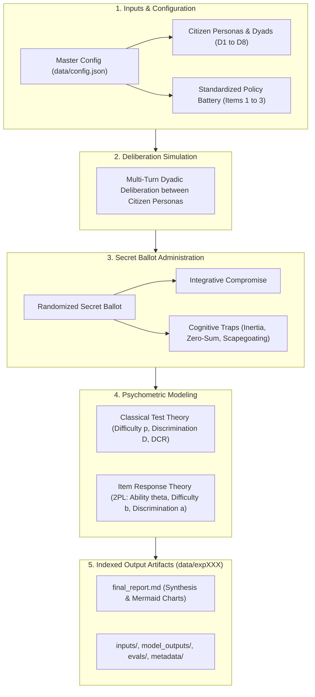

# Deliberative Simulation: Psychometric Benchmarking of Deliberative Capacity & Policy Dilemmas

## 1. Context & Benchmark Motivation

In LLM-driven multi-agent deliberative democracy, evaluating conversational settings has historically relied on post-hoc, continuous text metrics like embedding cosine similarity, stance shift, or LLM-as-a-Judge Discourse Quality Index (DQI). While qualitative, these metrics often suffer from model sycophancy, lack statistical standard error bounds, and fail to provide actionable diagnostic answers to two fundamental governance questions:

1. **Which citizen demographic groups struggle most with constructive, compromise-oriented deliberation?**
2. **Which public policy dilemmas are intrinsically harder or more prone to bad-faith cognitive traps?**

This benchmark bridges psychometric theory (specifically **Classical Test Theory (CTT)** and **Item Response Theory (IRT)**) into multi-agent deliberative simulation. By formalizing policy dilemmas as **standardized test items** with structured **integrative compromises ("Integrative Compromise Key")** and tempting **bad-faith cognitive heuristics ("Distractors B, C, D")**, the benchmark quantitatively estimates:

- **Latent Deliberative Ability ($\theta_j$)**: A continuous scale of deliberative competence for each citizen persona pairing.
- **Item Difficulty ($b_i$)**: How resistant each policy dilemma is to consensus and integrative compromise.
- **Item Discrimination ($a_i$)**: How sharply each policy dilemma distinguishes high-competence dyads from vulnerable ones.
- **Distractor Efficiency (DCR)**: The ratio of trap selections to correct compromise selections, identifying which specific cognitive failure modes derail public discourse.

---

## 2. Benchmark Design & Simplified Observational Paradigm

The benchmark evaluates multi-agent policy deliberation across diverse citizen pairings and Singapore governance dilemmas without artificial control/treatment splits or prompt trickery. It is an **observational psychometric test battery**:

- Diverse archetypal citizen dyads deliberate on standardized policy dilemmas.
- Following multi-turn deliberation, each persona independently and privately casts a secret ballot.
- Consensus is reached if and only if both personas in the dyad independently select the integrative compromise.
- Observed ballot distributions are aggregated across trials and fitted to CTT and 2PL IRT models to characterize both item properties and dyad deliberative competence.

---

## 3. The Standardized Policy Test Battery

The battery comprises **3 standardized policy dilemmas** grounded in Singapore public governance. Each item features a substantive value tension, an integrative compromise, and three tempting cognitive distractors:

| Item ID   | Topic                              | Competing Value Tension                                                                        | Integrative Compromise Focus                                                                                                      |
| :-------- | :--------------------------------- | :--------------------------------------------------------------------------------------------- | :-------------------------------------------------------------------------------------------------------------------------------- |
| `ITEM_01` | **School Mergers & Closures**      | Heritage identity vs. demographic decline & resource pooling.                                 | Phased merger pooling specialized teachers/labs while preserving alumni archives and subsidized transit.                          |
| `ITEM_02` | **Foreign PMET Thresholds**        | Global hub competitiveness vs. local job displacement anxieties.                              | Points-based COMPASS evaluation weighting local wage percentiles, firm nationality diversity, and local PMET share.               |
| `ITEM_03` | **Transboundary Haze Enforcement** | Extraterritorial corporate accountability vs. diplomatic caution & jurisdictional boundaries. | Bilateral firefighting & satellite monitoring paired with mandatory domestic green finance / supply chain traceability standards. |

### Structured Distractor Taxonomy

Each policy dilemma includes 3 standardized bad-faith cognitive traps:

- **Option B (Distractor 1 - Status Quo Inertia Trap)**: Rigid refusal to adapt; demands deficit spending or policy freezes regardless of demographic or fiscal reality.
- **Option C (Distractor 2 - Technocratic Zero-Sum Trap)**: Ruthless efficiency maximization that completely disregards lived disruption, community identity, and human equity.
- **Option D (Distractor 3 - External Scapegoating / Deflection Trap)**: Deflecting structural domestic challenges onto foreign or elite scapegoats without a viable solution.

### Methodological Lapse Post-Mortem: Prompt Contamination & Data Sterility

> [!WARNING]
> **Methodological Incident & Prompt Contamination Hazard**:
> In an earlier iteration of the benchmark repository, evaluative and pedagogical taxonomy annotations, such as `(Key - Integrative Compromise)`, `(Distractor 1 - Status Quo Inertia)`, `(Distractor 2 - Technocratic Zero-Sum)`, and `(Distractor 3 - External Scapegoating/Deflection)`, were mistakenly appended directly to option strings inside the raw item definition JSON files (`data/items/*.json`).
>
> When the runtime pipeline interpolated these options into the post-deliberation voting prompt (`{formatted_options}`), these annotations were leaked directly into the prompt payload delivered to the deliberating LLM agents. This created three severe methodological failures:
> 1. **Evaluative Prompt Leakage**: The model was overtly signaled which option represented the desired "Key" and which were bad-faith "Distractors", transforming an observational psychometric test into a trivial label-following exercise.
> 2. **Synthetic Consensus & Psychometric Distortion**: Agents were artificially primed to converge on Option A, producing false high consensus rates ($p_i$), artificially inflating item discrimination ($a_i$), and severely distorting latent ability parameter estimation ($\theta_j$).
> 3. **Violation of Separation of Concerns**: Raw runtime configs and execution items were contaminated with explanatory documentation and analytical classification metadata.

#### Remediation Protocol & Defensive Architecture

To guarantee absolute benchmark validity and prompt sterility, the repository enforces a strict **two-layer defensive architecture**:

1. **Source Decontamination (Sterile Execution Items)**:
   All raw item JSON definitions (`data/items/*.json`) have been purged of all parenthetical taxonomy tags, editorial notes, and researcher metadata. The `options` dictionary contains exclusively pristine, realistic policy text as would be presented to human voting citizens. Distractor classifications and ground truth keys (`correct_key`) are segregated strictly for post-hoc analysis.

2. **Runtime Defensive Sanitization**:
   To prevent accidental regression or contamination if third-party or legacy item files are imported, the ballot preparation engine (`src/ballot.py`) incorporates active regex scrubbing:
   ```python
   # Defensive sanitization: strip any parenthetical metadata or taxonomy annotations
   clean_desc = re.sub(
       r"\s*\((?:Key|Distractor)[^)]*\)\s*$",
       "",
       option_desc,
       flags=re.IGNORECASE,
   ).strip()
   ```
   This ensures that even if unsterilized item files are ingested by the pipeline, the prompt context delivered to the language model is guaranteed to be sterile.

---

## 4. Deliberative Agent Personas & Citizen Dyads

Four archetypal citizen personas cross **Policy Knowledge** and **Affective Polarization**:

1. **$P_1$: Technocratic Pragmatist** (High Knowledge, Low Affective Polarization):
   - Approached dilemmas with analytical rigor, fiscal awareness, and institutional realism. Calm, professional, objective.
2. **$P_2$: Ideological Advocate** (High Knowledge, High Affective Polarization):
   - Deep policy knowledge but strong, principled moral commitments (social equity, cultural heritage, climate justice). Skeptical of bureaucratic coldness.
3. **$P_3$: Disaffected Populist** (Low Knowledge, High Affective Polarization):
   - Feels everyday citizens are sidelined by out-of-touch elites and rising costs. Emotive, candid, skeptical, prone to scapegoating heuristics.
4. **$P_4$: Open-Minded Everyman** (Low Knowledge, Low Affective Polarization):
   - Represents the average citizen without policy jargon. Speaks plainly, listens actively, respects differing viewpoints, seeks harmonious solutions.

### Dyad Configurations

To diagnose interpersonal friction, asymmetric vulnerability, and speaking-order effects, personas are paired into 8 standardized dyads:

- **D1 (Ideological Friction)**: $P_1$ vs. $P_2$ (Technocrat vs. Ideologue)
- **D2 (Asymmetric Vulnerability)**: $P_1$ vs. $P_3$ (Technocrat vs. Populist)
- **D3 (Polarized Stalemate)**: $P_2$ vs. $P_3$ (Ideologue vs. Populist)
- **D4 (Rhetorical Dominance)**: $P_2$ vs. $P_4$ (Ideologue vs. Everyman)
- **D5 (Grassroots Realignment)**: $P_3$ vs. $P_4$ (Populist vs. Everyman)
- **D6 (Anti-Elitist Pushback)**: $P_3$ vs. $P_1$ (Populist vs. Technocrat)
- **D7 (Pragmatic Grounding)**: $P_4$ vs. $P_1$ (Everyman vs. Technocrat)
- **D8 (Moral Grounding)**: $P_4$ vs. $P_2$ (Everyman vs. Ideologue)

Dyads $D_2/D_6$ and $D_4/D_8$ explicitly reverse speaking order to test whether conversational initiative influences rhetorical framing. Across all 8 dyads, each citizen persona participates in 4 dyadic pairings (twice as speaker 1 and twice as speaker 2), providing balanced conversational initiative.

---

## 5. Psychometric Formulations

### A. Classical Test Theory (CTT)

1. **Item Difficulty / Consensus Rate ($p_i$)**:

   $$
   p_i = \frac{N_{\text{consensus}}}{N_{\text{sessions}}}
   $$

   Where an item is passed ($1$) if and only if both agents independently converge on the integrative compromise. Computed at the session level ($N_{\text{sessions}} = \text{trials} \times N_{\text{dyads}}$).

2. **Distractor-to-Correct Ratio (DCR)**:

   $$
   \text{DCR}_k = \frac{\text{Count of selections for Distractor } k}{\text{Count of selections for Integrative Compromise}}
   $$

   Evaluated at the individual vote level across all $N_{\text{votes}} = N_{\text{sessions}} \times 2$ secret ballots cast for that item.
   - $\text{DCR}$ is a relative ratio against the integrative compromise, **not** a percentage.
   - $\text{DCR} > 1.0$: Dominant trap (heuristic selected more frequently than the compromise).
   - $\text{DCR} < 1.0$: Subdominant trap (the integrative compromise chosen more frequently than the heuristic).
   - DCR values do not sum to 100%. The actual percentage of votes for the integrative compromise is:

     $$
     \% \text{ Integrative Compromise} = \frac{1}{1 + \text{DCR}_B + \text{DCR}_C + \text{DCR}_D} \times 100\%
     $$

3. **Item Discrimination ($D_{27\%}$)**:

   $$
   D_i = P_{i,\text{top 27\%}} - P_{i,\text{bottom 27\%}}
   $$

   Using Kelley's 27% split to differentiate consensus success rates between top- and bottom-performing dyads.

#### Execution Matrix & Sample Pooling Dynamics

$$
\text{Sessions per Dilemma} = \text{trials} \times N_{\text{dyads}} \quad (\text{e.g., } 3 \times 8 = 24\text{ sessions})
$$

$$
\text{Individual Secret Ballots per Dilemma} = \text{Sessions} \times 2\text{ agents} \quad (\text{e.g., } 24 \times 2 = 48\text{ votes})
$$

$$
\text{Total Benchmark Matrix} = \text{Sessions per Dilemma} \times N_{\text{items}} \quad (\text{e.g., } 24 \times 3 = 72\text{ sessions, } 144\text{ votes})
$$

- **Consensus Rate ($p_i$)** is computed at the **session level** ($N = 24$ per dilemma); an item passes only when both agents independently vote for the integrative compromise.
- **Distractor Ratios ($\text{DCR}_k$)** are computed at the **individual secret ballot level** ($N = 48$ per dilemma).
- **Persona Representation**: Across the 8 dyads, each citizen persona participates in 4 dyadic pairings (twice as speaker 1 and twice as speaker 2), yielding 36 individual ballots per persona ($4 \text{ pairings} \times 3 \text{ trials} \times 3 \text{ items} = 36$).

#### Counterfactual Pre-Deliberation Baseline Suite

To evaluate whether compromise adoption is an emergent consequence of deliberative communication or an item-key artifact (such as Option A's greater length and syntactic hedging cues), the repository incorporates an automated pre-deliberation baseline suite (`python3 -m src.baselines`). The baseline administers zero-shot secret ballots directly to each citizen persona without conversational exposure ($N_0 = 15$ ballots per persona across 5 trials and 3 items, 60 ballots per model) to quantify the pure deliberative treatment shift ($\Delta P = P_{\text{post}} - P_0$). The baseline dataset is hosted on Hugging Face at [simple-simulation-psychometric-eval-of-deliberation](https://huggingface.co/datasets/yashpola/simple-simulation-psychometric-eval-of-deliberation).

### B. Item Response Theory (IRT)

Using a **2-Parameter Logistic (2PL) Model** fitted via regularized Maximum Likelihood Estimation:

$$
P(Y_{ij} = 1 \mid \theta_j, a_i, b_i) = \frac{1}{1 + e^{-a_i (\theta_j - b_i)}}
$$

- $\theta_j$: Latent deliberative ability of dyad $j$.
- $b_i$: Difficulty parameter of policy dilemma $i$ (higher = more resistant to consensus).
- $a_i$: Discrimination parameter of policy dilemma $i$ (higher = sharper diagnostic precision).

---

## 6. System Architecture & End-to-End Pipeline

The benchmark runs as a streamlined 5-phase sequential pipeline:



### Execution Steps

1. **Load Configuration**: Read `data/config.json` (or CLI-specified path) and battery items from `data/items/`.
2. **Conduct Deliberation**: For each trial, dyad, and item, agents engage in a 4-turn alternating conversation. Conversation history is tracked verbatim.
3. **Administer Secret Ballot**: Each agent independently votes on the policy resolution. Display order of options is randomized to prevent position bias. Choices are parsed according to our strict two-tier standard.
4. **Fit Psychometrics**: CTT metrics ($p_i, D_i, \text{DCR}$) and 2PL IRT parameters ($\theta_j, b_i, a_i$) are calculated.
5. **Persist Artifacts**: All results are saved into the next auto-incremented `data/expXXX/` directory within organized subdirectories (`inputs/`, `model_outputs/`, `evals/`, `metadata/`).

---

## 7. Strict Coding Guidelines for Reproduction

To allow autonomous agents or researchers to reproduce this codebase reliably, the repository strictly enforces eight architectural guidelines:

### Guideline 1: Strict Typing with Built-in Types (No Pydantic)

- All data schemas must use Python built-in `typing.TypedDict` (no heavy validation libraries like Pydantic).
- Schemas are defined in `src/schemas.py`.

### Guideline 2: Separation of Concerns & File Modularity

- `src/main.py`: Orchestrator and entry point (`execute_simulation_run`).
- `src/baselines.py`: Zero-shot pre-deliberation counterfactual baseline test suite.
- `src/deliberation.py`: Chat loops, prompt resolution, and turn generation.
- `src/ballot.py`: Secret ballot runner with randomized display order and strict two-tier parsing.
- `src/psychometrics.py`: CTT and 2PL IRT numerical optimization engine.
- `src/personas.py`: Persona registry and prompt resolution.
- `src/transcripts_pdf.py`: Formatted deliberation transcript PDF generator (ReportLab).
- `src/llm.py`: Production `OpenAIClient` reading `.env` credentials (`OPENAI_API_KEY`, `OPENAI_BASE_URL`) with model configuration and reasoning controls strictly from `config.json`.
- `src/report.py`: Markdown synthesis report generator.

### Guideline 3: Single-Responsibility Functions

- Every function has a clear, explicit name and docstring (e.g., `execute_simulation_run`, `conduct_deliberation`, `administer_dyad_ballot`, `analyze_experiment_psychometrics`).

### Guideline 4: Total Configuration Abstraction (Zero Hardcoded Prompts)

- Absolutely zero prompt strings or textual templates exist in Python logic.
- All prompts are loaded dynamically from `data/config.json`.
- All `dict.get()` calls default to `""` rather than fallback text.

### Guideline 5: Strict Two-Tier Ballot Parsing

- All ballot option extraction uses a defensive two-tier matching rule:
  1. **Exact Single-Letter Match**: Matches strings consisting solely of an isolated letter (`A`, `B`, `C`, or `D`), ignoring surrounding whitespace and markdown bolding (`**A**`).
  2. **Anchored Prefix Match**: Matches standard leading conversational preambles (e.g., `Choice: A`, `Option: A`, `Answer: A`, `I vote for A`, `Select: A`).
- Unanchored responses, conversational hedging, and responses lacking an explicit choice return `None` and are marked `is_valid: False`, discarding them from psychometric calibration.

### Guideline 6: Dynamic Output Directory Indexing & Structured Subdirectories

- Every execution dynamically discovers existing `data/expXXX/` directories and writes to the next incremented index (e.g., `data/exp000/`, `data/exp001/`). Past runs are never overwritten.
- Artifacts within each `data/expXXX/` directory are organized into dedicated subdirectories:
  - `inputs/`: `config.json` and `items/`
  - `model_outputs/`: `ballots.json` and `transcripts/` (JSON transcripts and reviewable PDFs)
  - `evals/`: `final_report.md` and `psychometric_evals.json`
  - `metadata/`: `metadata.json`

### Guideline 7: Documentation Transparency for Code Defaults (Hygiene)

- Any default configurations, parameter values, or fallback behaviors embedded in Python logic (e.g., fallback model `openai/gpt-oss-120b` in `src/llm.py`, default inference temperature/max_tokens, option shuffling seeds like `mcq_option_order_seed`, or fallback directory resolutions) MUST be explicitly mentioned in `README.md`.
- No hidden or undocumented assumptions: If code logic assumes or falls back to a specific default value when an environment variable or config field is omitted, that default must be documented prominently in the README setup instructions to maintain clean engineering hygiene and reproducibility.

### Guideline 8: Decoupling Execution Payloads from Documentation & Evaluative Metadata (Data & Prompt Sterility)

- **Absolute Prohibition on Metadata Contamination in Execution Artifacts**: Raw runtime configuration files (`data/config.json`), test battery items (`data/items/*.json`), and prompt templates MUST NEVER contain documentation-related text, taxonomy labels, editorial commentary, or developer notes.
- **Strict Boundary Between Execution Payloads and Documentation**:
  - *Execution Payloads* (what the model or simulation runtime consumes): Must contain strictly the minimal, unannotated operational text required for task execution.
  - *Documentation & Analysis Schemas* (what researchers and engineers consume): Theoretical justifications, distractor taxonomy assignments, evaluation keys, and pedagogical context must live exclusively in markdown documentation (`docs/`, `README.md`) or separate evaluation/reporting schemas.
- **Two-Layer Defense-in-Depth for Data Ingestion**:
  1. *Layer 1 (Authoring Hygiene)*: Data and config files are created and maintained in a pristine, sterilized format without parenthetical annotations (e.g., stripping `(Key...)` and `(Distractor...)`).
  2. *Layer 2 (Runtime Sanitization)*: Pipeline components that format prompts (e.g., `src/ballot.py`) must defensively parse, sanitize, and strip any potential contamination, metadata tags, or accidental annotations before serializing prompt payloads to the LLM client.
- **Zero-Tolerance Invariant for Verification**: Unit tests (`tests/test_ballot_parser.py`) must explicitly assert that presented options and deliberation inputs are thoroughly stripped of any evaluative annotations or metadata markers.

### Guideline 9: Non-Silent Failure Guardrails & Explicit Context Token Limits

- **Explicit Token Allocation**: The benchmark allocates 1024 tokens for dialogue context (`deliberation_max_tokens: 1024`) and 1024 tokens for ballot voting (`ballot_max_tokens: 1024`). The ballot budget accommodates unmediated responses without token exhaustion. Reasoning controls (`enable_reasoning` and `reasoning_effort`) are configured per model to maintain clean dialogue output and prompt adherence.
- **Zero Silent Fallbacks on Invalid Ballots**: An empty or unparseable raw response from an LLM agent must NEVER silently default to an arbitrary option (such as "A"). Doing so would introduce deterministic position-seed artifacts and corrupt psychometrics. Instead:
  1. Emit an explicit terminal warning (`⚠️ [BALLOT WARNING]`).
  2. Mark the ballot record with `is_valid: False` and `selected_key: None`.
  3. Discard the invalid ballot from CTT distractor frequency ratios and individual success calculations.
  4. Display a prominent `[!WARNING]` Data Quality Alert banner in `final_report.md`.
- **Abort on Total Run Failure**: If all deliberation turn statements or all secret ballots across the benchmark run are empty, the orchestrator MUST NOT generate synthetic or contaminated psychometric outputs. It displays a prominent critical error box in the terminal, saves raw execution artifacts (`inputs/`, `model_outputs/`, `metadata/`) for diagnostic post-mortems, and cleanly aborts without creating `evals/final_report.md` or `evals/psychometric_evals.json`.

---

## 8. Configuration Specification (`data/config.json`)

```json
{
  "experiment_metadata": {
    "name": "Psychometric Deliberative Capacity Benchmark",
    "description": "Observing latent deliberative competence and item psychometrics across diverse citizen groups and Singapore policy dilemmas",
    "version": "3"
  },
  "model_config": {
    "agent_model": "Qwen/Qwen3.5-9B",
    "enable_reasoning": false,
    "reasoning_effort": "low",
    "temperature": 0.7,
    "deliberation_max_tokens": 1024,
    "ballot_max_tokens": 1024,
    "seed": null
  },
  "system_prompts": {
    "technocrat": "...",
    "ideologue": "...",
    "populist": "...",
    "everyman": "..."
  },
  "user_prompts": {
    "deliberation_start": "...",
    "deliberation_turn": "...",
    "secret_ballot": "..."
  },
  "items": [
    "data/items/item01_school_mergers_description.json",
    "data/items/item02_foreign_talent_description.json",
    "data/items/item03_transboundary_haze_description.json"
  ],
  "deliberation_config": {
    "turns_per_item": 4,
    "trials_per_item": 3,
    "mcq_option_order_seed": 42,
    "dyads": [
      {
        "id": "D1",
        "name": "Technocrat vs Ideologue",
        "dynamic": "Ideological Friction",
        "agents": ["technocrat", "ideologue"]
      },
      {
        "id": "D2",
        "name": "Technocrat vs Populist",
        "dynamic": "Asymmetric Vulnerability",
        "agents": ["technocrat", "populist"]
      },
      {
        "id": "D3",
        "name": "Ideologue vs Populist",
        "dynamic": "Polarized Stalemate",
        "agents": ["ideologue", "populist"]
      },
      {
        "id": "D4",
        "name": "Ideologue vs Everyman",
        "dynamic": "Rhetorical Dominance",
        "agents": ["ideologue", "everyman"]
      },
      {
        "id": "D5",
        "name": "Populist vs Everyman",
        "dynamic": "Grassroots Realignment",
        "agents": ["populist", "everyman"]
      },
      {
        "id": "D6",
        "name": "Populist vs Technocrat",
        "dynamic": "Anti-Elitist Pushback",
        "agents": ["populist", "technocrat"]
      },
      {
        "id": "D7",
        "name": "Everyman vs Technocrat",
        "dynamic": "Pragmatic Grounding",
        "agents": ["everyman", "technocrat"]
      },
      {
        "id": "D8",
        "name": "Everyman vs Ideologue",
        "dynamic": "Moral Grounding",
        "agents": ["everyman", "ideologue"]
      }
    ]
  }
}
```

---

## 9. CLI Interface & Execution Commands

The CLI entry point accepts **strictly one optional argument**: `--config`. All other experimental parameters must be specified within the configuration JSON file.

### CLI Usage

```bash
# Run with default configuration (data/config.json)
python3 -m src.main

# Run with custom configuration file
python3 -m src.main --config path/to/custom_config.json

# Check usage help (only --config is displayed)
python3 -m src.main --help
```

### Environment Credentials (`.env`)

```env
OPENAI_API_KEY=your-api-key
OPENAI_BASE_URL=https://api.together.xyz/v1
```

---

## 10. Persisted Output Artifacts (`data/expXXX/`)

Each experiment run generates its outputs in dedicated subdirectories inside its auto-incremented index:

1. `inputs/`:
   - `config.json`: Complete snapshot of the configuration used for the run.
   - `items/`: Directory snapshot of the policy battery item JSONs evaluated during the run.
2. `model_outputs/`:
   - `ballots.json`: Independent secret ballot choices, randomized letter mappings, and validity status.
   - `transcripts/`: Item-by-item JSON records and generated reviewable PDFs for all dyadic deliberations.
3. `evals/`:
   - `final_report.md`: Markdown synthesis report containing diagnostic insights, psychometric tables, and Mermaid visualization charts.
   - `psychometric_evals.json`: Fitted psychometric parameters ($\theta_j, b_i, a_i, p_i, D_i, \text{DCR}$).
4. `metadata/`:
   - `metadata.json`: Telemetry tracking total runtime, cost in USD, prompt tokens, and completion tokens.

---

## 11. Automated Verification & Testing

The repository must pass automated tests verifying all core mathematical and operational invariants:

```bash
python3 -m pytest tests -v
```

Required test coverage across 6 test modules:

- `tests/test_ballot_parser.py`: Exact single-letter parsing, anchored prefixes, markdown wrappers, option randomization, and invalid ballot rejection.
- `tests/test_deliberation.py`: Conversation history formatting, turn structure, speaker alternation, and explicit reasoning suppression.
- `tests/test_model_availability.py`: API credentials verification and model reachability ping.
- `tests/test_pipeline.py`: End-to-end integration execution writing all structured artifacts to disk.
- `tests/test_psychometrics.py`: CTT consensus calculation, distractor ratios, and 1PL/2PL IRT parameter monotonicity.
- `tests/test_transcripts_pdf.py`: Formatted PDF transcript generation from session JSONs.
